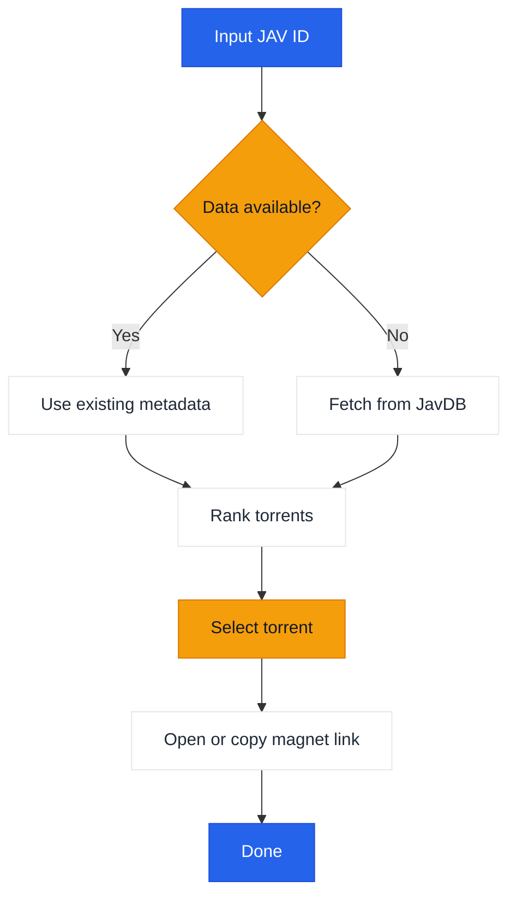

# JavManager

A lightweight GUI + CLI tool for searching JAV metadata and torrents, then opening or copying magnet links.

[繁體中文](README.zh-TW.md) | [日本語](README.ja.md) | [한국어](README.ko.md)

## Usage

```bash
# GUI
npx jav-manager --gui

# CLI (interactive)
npx jav-manager

# CLI (non-interactive)
npx jav-manager STARS-001

# Help / version
npx jav-manager help
npx jav-manager version

# Subtitle search
npx jav-manager sub STARS-001
```

## Repository Layout

```text
apps/
  backend-worker/   Cloudflare backend worker
  cli/              CLI entrypoint + console UI
  gui/              GUI entrypoint + local web UI
packages/
  domain/           Shared models and interfaces
  shared-utils/     Pure helper utilities
  core/             Shared Node runtime (config/services/data/i18n)
scripts/            Repo-level dev/build helpers
bin/                Published CLI launcher
doc/                External API notes
test/               Node test suite
```

Notes:
- Replace `npx jav-manager` with `jav-manager` if you installed it globally (`npm install -g jav-manager`).
- Torrent clients can open a magnet link from the GUI or CLI output.

## Features

- GUI (local web UI) and console mode (Node.js)
- Multilingual UI (English, Chinese, Japanese, Korean)
- Search JAV metadata and torrents/magnets from JavDB
- Search external subtitles by JAV ID from SubtitleCat and optional index sites
- Open or copy selected magnet links
- Local JSON cache for repeat searches
- Smart torrent selection with weight-based ranking (markers + weights)

## Workflow



## External Dependencies

| Service | Required | Purpose | Link |
|---------|----------|---------|------|
| JavDB App API | Yes | Metadata & magnet links | [`doc/javdb-app-api/README.md`](doc/javdb-app-api/README.md) |
| SubtitleCat | No (optional) | External subtitle search | [subtitlecat.com](https://www.subtitlecat.com/) |

### Backend Worker APIs (Optional)

If `Telemetry:Enabled` is true, JavManager can post compatibility events to the backend worker:

- A startup event to `POST /api/telemetry`
- JAV metadata to `POST /api/javinfo` (used by the worker UI; repeated reports increment the per-ID search counter)

The backend worker also serves a small UI:

- `/` overview
- `/jav` "Jav Trends" (recent JavInfo records + search counts)

## Configuration

Settings are configured via `appsettings.json` (and optional `appsettings.Development.json`).

Config file location:
- If `JAVMANAGER_CONFIG_DIR` is set and exists, config is read from there.
- Otherwise, JavManager looks for `appsettings.json` in the executable directory first, then the current working directory.
- GUI "Settings" and CLI `cfg set ...` write `appsettings.json` to the selected config directory (see lookup rules above).

Configuration reference:

| Section | Key | Required | Default | Description |
|---------|-----|----------|---------|-------------|
| JavBackend | `BaseUrl` | Yes | `https://apidd.spthgb.com` | Primary JavDB App API base URL (or backend worker base URL). |
| JavDb | `MirrorUrls` | No (optional) | `[]` | Additional App API base URLs for fallback. |
| JavDb | `RequestTimeout` | No (optional) | `30000` | Request timeout in milliseconds. |
| JavDb | `UserAgent` | No (optional) | _(empty)_ | Custom User-Agent string for JavDB requests. |
| Subtitle | `Enabled` | No (optional) | `true` | Enable CLI subtitle search (`sub <id>`). |
| Subtitle | `BaseUrl` | No (optional) | `https://www.subtitlecat.com` | SubtitleCat base URL. |
| Subtitle | `SavePath` | No (optional) | _(empty)_ | Directory for downloaded `.srt` files. Falls back to `subtitles/` in the config directory. |
| Subtitle | `PreferredLanguages` | No (optional) | `zh-CN, zh, zh-TW` | Language preference when a subtitle has multiple ready downloads. |
| Subtitle | `IndexSites` | No (optional) | JavSubtitled, Javzimu | Extra HTML index sites searched by JAV ID. Unreachable sites are skipped. |
| LocalCache | `Enabled` | No (optional) | `true` | Enable or disable local cache storage. |
| LocalCache | `DatabasePath` | No (optional) | _(empty)_ | JSON cache file path (leave empty for default `jav_cache.json` next to executable). |
| LocalCache | `CacheExpirationDays` | No (optional) | `0` | Cache TTL in days (0 disables expiration). |
| Console | `Language` | No (optional) | `en` | UI language (`en` or `zh`). |
| Console | `HideOtherTorrents` | No (optional) | `true` | Hide non-matching torrents in list. |
| Telemetry | `Enabled` | No (optional) | `true` | Enable or disable anonymous telemetry. |
| Telemetry | `Endpoint` | No (optional) | `https://jav-manager.techfetch.dev` | Base endpoint (the app posts to `/api/telemetry` and `/api/javinfo`). |
| Update | `Enabled` | No (optional) | `true` | Enable or disable update checks. |
| Update | `AutoCheckOnStartup` | No (optional) | `true` | Auto-check for updates on startup (GUI). |
| Update | `GitHubRepo` | No (optional) | `jqknono/jav-manager` | GitHub repo used for update checks. |

Notes:
- `JavInfoSync:*` is a legacy section name; newer builds use `Telemetry:*` (the app still reads the legacy keys for backward compatibility).
- Advanced: configuration also supports environment variables with the `JAVMANAGER_` prefix (nested keys use `__`), but file-based config is the primary supported method.

## Development

Worker 开发工具链使用 Wrangler 4.152+，需要 Node.js 22 或更新版本；建议仓库开发统一使用 Node.js 24。

```bash
# Install deps
npm install

# Build all subprojects
npm run build

# Run compiled CLI / GUI
npm run gui
npm run cli

# Local development
npm run dev:backend
npm run dev:cli
npm run dev:gui

# Tests
npm test
```

### Local Backend Wiring

- `npm run dev:backend` starts the Cloudflare Worker locally on `http://127.0.0.1:8788`
- `npm run dev:cli` and `npm run dev:gui` default to `JAVMANAGER_BACKEND_ENDPOINT=http://127.0.0.1:8788`
- Override the backend explicitly with `JAVMANAGER_BACKEND_ENDPOINT` or `JAVMANAGER_BACKEND_URL`

### Build Boundaries

- `npm run build:domain` builds `packages/domain`
- `npm run build:shared-utils` builds `packages/shared-utils`
- `npm run build:core` builds `packages/core`
- `npm run build:cli` builds `apps/cli`
- `npm run build:gui` builds `apps/gui`
- `npm run build:backend` builds `apps/backend-worker`
- `npm run build:runtime` bundles the internal client packages into `runtime/*.cjs`

### 模块职责与发布

- `packages/core/src/services.ts` 保持公共导出兼容；实现按健康检查、选种、字幕、搜索、JavInfo 上报和事件遥测拆入 `services/`。
- `apps/backend-worker/src/index.ts` 负责公共上下文和路由分派；管理员会话、遥测、JavInfo、JavDB 代理与存储分别在对应模块维护。
- `npm pack` 的 `prepack` 执行完整构建。发布包只包含 `runtime/*.cjs`、启动器、许可证和 README；内部 workspace 与语言 JSON 内联到运行脚本，第三方依赖由 npm 安装。
- `.d.ts` 仍由开发构建生成供包间类型检查使用，npm 应用发行包仅提供运行时 API；`require("jav-manager")` 加载 core 导出。
- `npm test` 包括 Worker 离线契约、core 服务和真实 tarball 隔离运行测试；单独运行 `npm run test:package` 前执行 `npm run build`。

### Worker 域名接口与依赖审计

- `GET /api/javdb-domain` 为独立公共接口，返回 `{ "success": true, "domains": ["最新域名"] }`，复用一小时内存缓存；上游读取失败时返回 HTTP 500。
- `/api/javdb` 及其 `/` 子路径由代理模块处理，并保持原有代理认证；域名查询及其 OPTIONS 使用通用 CORS。
- 根工作区和 `apps/backend-worker` 使用独立锁文件，分别运行 `npm audit` 与 `npm --prefix apps/backend-worker audit`。
- GitHub Actions 工作流 [依赖安全审计](.github/workflows/dependency-audit.yml) 在 push、PR、每周一 UTC 03:17 和手动触发时运行。`audit-root` 与 `audit-worker` 独立审计两份锁文件，包含开发依赖；低危及以上漏洞或审计请求失败均使检查失败，JSON 报告保留 14 天。
- 本地复现 CI：在根目录运行 `npm audit --package-lock-only --include=dev --audit-level=low`，并运行 `npm --prefix apps/backend-worker audit --package-lock-only --include=dev --audit-level=low`。工作流直接审计锁文件，无需安装依赖或执行安装脚本。
- 启用合并门禁时，在仓库分支保护或 ruleset 中将 `audit-root`、`audit-worker` 都设为必需检查；定时与手动运行使用默认分支上的工作流。
- 升级 Wrangler 时同步满足 `@cloudflare/workers-types` 的 peer 版本要求，并执行 Worker 构建、离线契约测试及 `wrangler deploy --dry-run` 本地打包校验。
