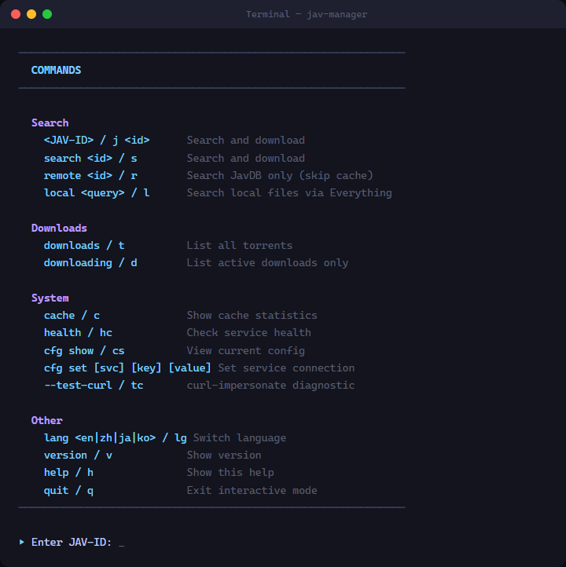
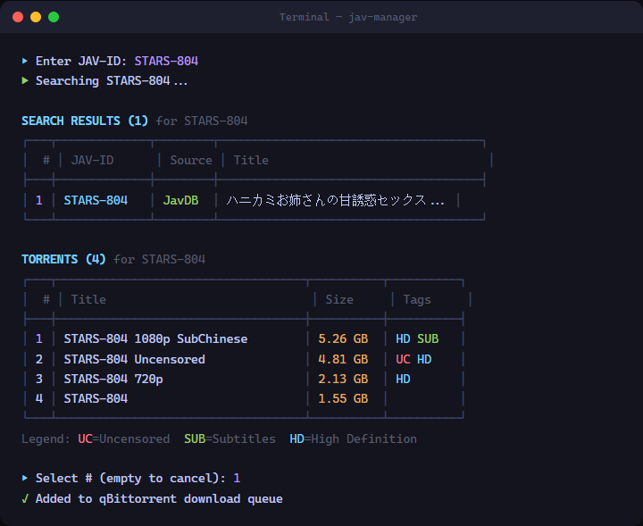
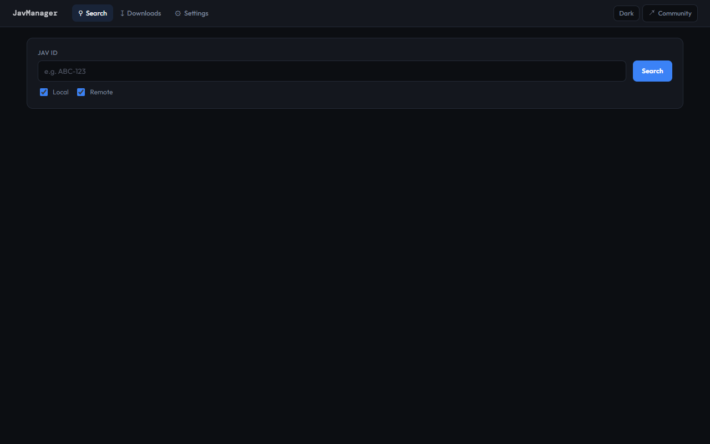
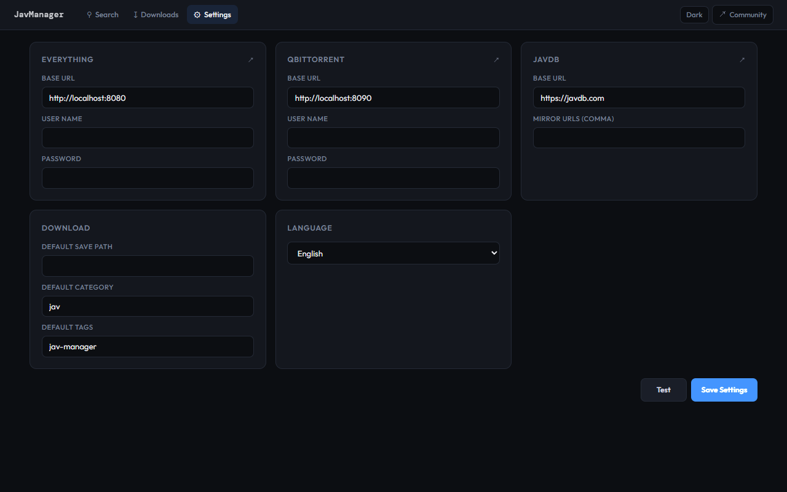
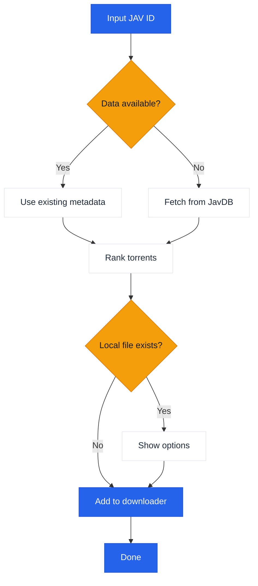

# JavManager

A lightweight GUI + CLI tool for automated JAV content management with fast repeat searches, torrent search, and optional qBittorrent integration.

[繁體中文](README.zh-TW.md) | [日本語](README.ja.md) | [한국어](README.ko.md)

## Usage

```bash
# GUI
npx jav-manager --gui

# CLI (interactive)
npx jav-manager

# CLI (non-interactive)
npx jav-manager STARS-001

# Help / version
npx jav-manager help
npx jav-manager version

# Subtitle search
npx jav-manager sub STARS-001
```

## Repository Layout

```text
apps/
  backend-worker/   Cloudflare backend worker
  cli/              CLI entrypoint
  client/           Shared client runtime used by CLI / GUI
  gui/              GUI entrypoint
packages/
  shared/           Cross-runtime shared types and pure utilities
scripts/            Repo-level dev/build helpers
bin/                Published CLI launcher
doc/                External API notes
test/               Node test suite
```

Notes:
- Everything (local search) and qBittorrent (download) are optional integrations. JavManager works without them (it can still search JavDB and output magnet links).
- Replace `npx jav-manager` with `jav-manager` if you installed it globally (`npm install -g jav-manager`).
- If you need support for other tools with HTTP APIs (e.g., other search engines or download clients), please [create an issue](../../issues/new).

## Features

- GUI (local web UI) and console mode (Node.js)
- Multilingual UI (English, Chinese, Japanese, Korean)
- Search JAV metadata and torrents/magnets from JavDB
- Search external subtitles by JAV ID from SubtitleCat and optional index sites
- Check local files via Everything search engine
- Download via qBittorrent WebUI API
- Local JSON cache for repeat searches
- Smart torrent selection with weight-based ranking (markers + weights)

## Screenshots

### CLI

<p align="center">
  
</p>

<p align="center"><em>Interactive CLI — available commands and keyboard shortcuts</em></p>

<p align="center">
  
</p>

<p align="center"><em>Search results table and torrent selection with tags (HD / SUB / UC)</em></p>

### GUI

<p align="center">
  
</p>

<p align="center"><em>Web UI — search page with JAV ID input and filter options</em></p>

<p align="center">
  
</p>

<p align="center"><em>Web UI — settings page with service configuration and language selector</em></p>

## Workflow



## External Dependencies

| Service | Required | Purpose | Link |
|---------|----------|---------|------|
| JavDB App API | Yes | Metadata & magnet links | [`doc/javdb-app-api/README.md`](doc/javdb-app-api/README.md) |
| SubtitleCat | No (optional) | External subtitle search | [subtitlecat.com](https://www.subtitlecat.com/) |
| Everything | No (optional) | Local file search | [voidtools.com](https://www.voidtools.com/everything-1.5a/) ([HTTP plugin](https://www.voidtools.com/forum/viewtopic.php?f=12&t=9799)) |
| qBittorrent | No (optional) | Torrent download | [qBittorrent](https://github.com/qbittorrent/qBittorrent) |

### Backend Worker APIs (Optional)

If `Telemetry:Enabled` is true, JavManager can post compatibility events to the backend worker:

- A startup event to `POST /api/telemetry`
- JAV metadata to `POST /api/javinfo` (used by the worker UI; repeated reports increment the per-ID search counter)

The backend worker also serves a small UI:

- `/` overview
- `/jav` "Jav Trends" (recent JavInfo records + search counts)

## Configuration

Settings are configured via `appsettings.json` (and optional `appsettings.Development.json`).

Config file location:
- If `JAVMANAGER_CONFIG_DIR` is set and exists, config is read from there.
- Otherwise, JavManager looks for `appsettings.json` in the executable directory first, then the current working directory.
- GUI "Settings" and CLI `cfg set ...` write `appsettings.json` to the selected config directory (see lookup rules above).

Configuration reference:

| Section | Key | Required | Default | Description |
|---------|-----|----------|---------|-------------|
| Everything | `BaseUrl` | No (optional) | _(empty)_ | Everything HTTP server base URL (include scheme and host). If unavailable, local dedup is skipped. |
| Everything | `UserName` | No (optional) | _(empty)_ | Basic auth user name. |
| Everything | `Password` | No (optional) | _(empty)_ | Basic auth password. |
| QBittorrent | `BaseUrl` | No (optional) | _(empty)_ | qBittorrent WebUI base URL (include port if needed). If unavailable/auth fails, JavManager prints magnet links without adding to download queue. |
| QBittorrent | `UserName` | No (optional) | _(empty)_ | WebUI user name. |
| QBittorrent | `Password` | No (optional) | _(empty)_ | WebUI password. |
| JavDb | `BaseUrl` | Yes | `https://apidd.btyjscl.com` | Primary JavDB App API base URL. |
| JavDb | `MirrorUrls` | No (optional) | `[]` | Additional App API base URLs for fallback. |
| JavDb | `RequestTimeout` | No (optional) | `30000` | Request timeout in milliseconds. |
| JavDb | `UserAgent` | No (optional) | _(empty)_ | Custom User-Agent string for JavDB requests. |
| Download | `DefaultSavePath` | No (optional) | _(empty)_ | Default download path when adding torrents to qBittorrent. |
| Download | `DefaultCategory` | No (optional) | `jav` | Default category in qBittorrent. |
| Download | `DefaultTags` | No (optional) | `jav-manager` | Default tags for created downloads. |
| Subtitle | `Enabled` | No (optional) | `true` | Enable CLI subtitle search (`sub <id>`). |
| Subtitle | `BaseUrl` | No (optional) | `https://www.subtitlecat.com` | SubtitleCat base URL. |
| Subtitle | `SavePath` | No (optional) | _(empty)_ | Directory for downloaded `.srt` files. Falls back to `Download.DefaultSavePath`, then `subtitles/` in the config directory. |
| Subtitle | `PreferredLanguages` | No (optional) | `zh-CN, zh, zh-TW` | Language preference when a subtitle has multiple ready downloads. |
| Subtitle | `IndexSites` | No (optional) | JavSubtitled, Javzimu | Extra HTML index sites searched by JAV ID. Unreachable sites are skipped. |
| LocalCache | `Enabled` | No (optional) | `true` | Enable or disable local cache storage. |
| LocalCache | `DatabasePath` | No (optional) | _(empty)_ | JSON cache file path (leave empty for default `jav_cache.json` next to executable). |
| LocalCache | `CacheExpirationDays` | No (optional) | `0` | Cache TTL in days (0 disables expiration). |
| Console | `Language` | No (optional) | `en` | UI language (`en` or `zh`). |
| Console | `HideOtherTorrents` | No (optional) | `true` | Hide non-matching torrents in list. |
| Telemetry | `Enabled` | No (optional) | `true` | Enable or disable anonymous telemetry. |
| Telemetry | `Endpoint` | No (optional) | `https://jav-manager.techfetch.dev` | Base endpoint (the app posts to `/api/telemetry` and `/api/javinfo`). |
| Update | `Enabled` | No (optional) | `true` | Enable or disable update checks. |
| Update | `AutoCheckOnStartup` | No (optional) | `true` | Auto-check for updates on startup (GUI). |
| Update | `GitHubRepo` | No (optional) | `jqknono/jav-manager` | GitHub repo used for update checks. |

Notes:
- `JavInfoSync:*` is a legacy section name; newer builds use `Telemetry:*` (the app still reads the legacy keys for backward compatibility).
- Advanced: configuration also supports environment variables with the `JAVMANAGER_` prefix (nested keys use `__`), but file-based config is the primary supported method.

## Development

```bash
# Install deps
npm install

# Build all subprojects
npm run build

# Run compiled CLI / GUI
npm run gui
npm run cli

# Local development
npm run backend:dev
npm run dev:cli
npm run dev:gui

# Tests
npm test
```

### Local Backend Wiring

- `npm run backend:dev` starts the Cloudflare Worker locally on `http://127.0.0.1:8788`
- `npm run dev:cli` and `npm run dev:gui` default to `JAVMANAGER_BACKEND_ENDPOINT=http://127.0.0.1:8788`
- Override the backend explicitly with `JAVMANAGER_BACKEND_ENDPOINT` or `JAVMANAGER_BACKEND_URL`

### Build Boundaries

- `npm run build:shared` builds `packages/shared`
- `npm run build:cli` builds `apps/cli` and the shared client runtime it imports
- `npm run build:gui` builds `apps/gui` and the shared client runtime it imports
- `npm run build:backend` builds `apps/backend-worker`
